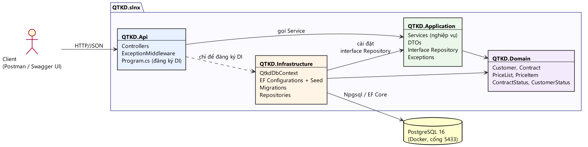
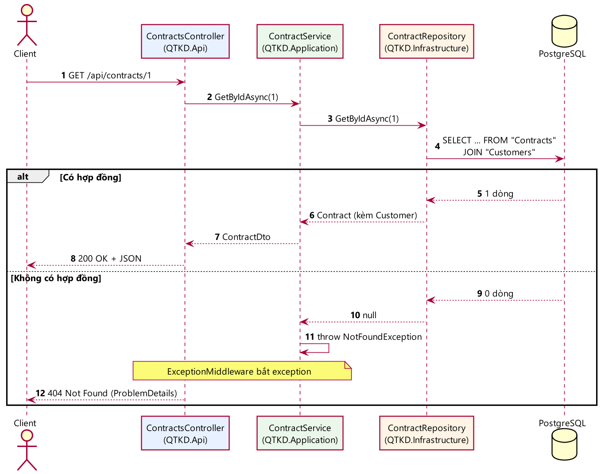
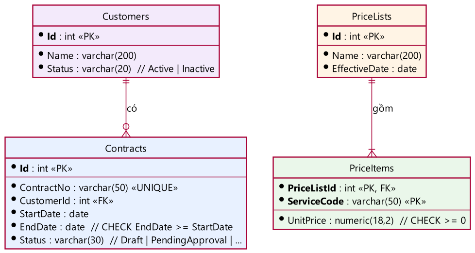

# Sơ đồ thành phần solution QTKD

Các sơ đồ được vẽ bằng **PlantUML**. Mã nguồn nằm trong [docs/diagrams](diagrams), ảnh PNG nằm ngay trong `docs/` để dán vào báo cáo.

Xuất lại ảnh sau khi sửa file `.puml` (cần Java và `plantuml.jar`; máy không có Graphviz nên sơ đồ thành phần và ERD dùng engine Smetana có sẵn qua `!pragma layout smetana`):

```powershell
java -jar plantuml.jar -charset UTF-8 -tpng -Sdpi=150 -o .. docs/diagrams/*.puml
```

## Các project và hướng phụ thuộc

Nguồn: [diagrams/architecture_components.puml](diagrams/architecture_components.puml)



| Project | Trách nhiệm | Tham chiếu |
|---|---|---|
| `QTKD.Domain` | Entity và enum trạng thái — trung tâm, không phụ thuộc framework nào | — |
| `QTKD.Application` | Nghiệp vụ (Service), DTO trả cho client, **interface** Repository, exception nghiệp vụ | Domain |
| `QTKD.Infrastructure` | Truy cập dữ liệu: `QtkdDbContext`, cấu hình bảng, seed, migration, **cài đặt** Repository bằng EF Core | Application, Domain |
| `QTKD.Api` | Nhận HTTP, gọi Service, chuyển exception thành mã lỗi HTTP; ghép các tầng trong `Program.cs` | Application, Infrastructure |

Điểm chính: tầng **Application không tham chiếu EF Core**. Service chỉ biết `ICustomerRepository`/`IContractRepository`; Infrastructure cài đặt chúng. Nhờ vậy nghiệp vụ (CTR-01..03 ở tuần 06) có thể unit test mà không cần database (tuần 07).

## Luồng xử lý một request

Nguồn: [diagrams/architecture_request_flow.puml](diagrams/architecture_request_flow.puml)



## Mô hình dữ liệu (tuần 05)

Nguồn: [diagrams/architecture_erd.puml](diagrams/architecture_erd.puml)


